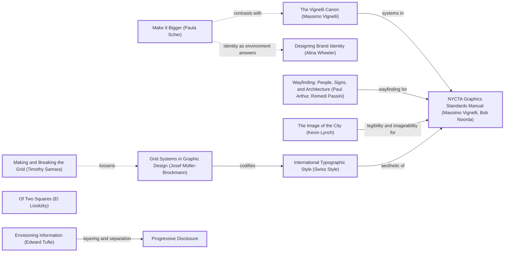

# DESIGN-LOG: Internet Structure redesign (DADA run, 2026-11-11)

## 1. Traversal Plan

**Brief, restated.** Overhaul the Internet Structure site so it looks far better, and make it as fast as possible on Next.js. (The inherited site was already Next.js 16 App Router, but it was a one-route client-side D3 app: the speed work is moving everything to build-time static HTML.)

**Mode: Adaptive.** The site serves a public audience (people trying to understand who runs the internet), so MAYA governs: the advanced pole (a poster-like cross-section with a single argued red line) and the acceptable pole (plain labels, a stated purpose, conventional navigation) must both hold.

**Run type: Full.** This is a redesign of the concept, structure and stack, so nothing is frozen. The Landing procedure runs inside it as the landing move (M3).

**Bound:** none stated by the person.

**Tooling inventory (Step 0).**

| Job | Tool used |
|---|---|
| Render and navigate the anchor graph | none available (no Mermaid renderer or graph DB in this session); the marked Mermaid text is kept in this log |
| Compute the Frontier | by hand from the edge lines of `references/anchor-graph.md` (grep) |
| Track workflow state | this log (checklist); no task tool used |
| Run the panel | Agent tool, one sub-agent per reference, at most three at a time, each filing to `design/panel/<round>/<seat>.md` |
| Collect panel reports | `scripts/collect_panel.py` |
| Choose the panel | `scripts/pick_panel.py --mode adaptive --run-type full --project internet_structure --data-graphic` |
| Brief each seat | the seat files in `seats/` (prompt template, trimmed to the evidence pointer) |
| Measure the artifact | Playwright (Chromium) via `design/measure.cjs` and screenshot scripts; `node --test` |
| Record the run | not done: the dada ledger repository is not attached to this session (see Compliance) |

**Seed (labels copied verbatim from the graph).**

- Stance: `Make It Bigger (Paula Scher)`
- Rules: `Grid Systems in Graphic Design (Josef Müller-Brockmann)` -->|codifies| `International Typographic Style (Swiss Style)` -->|aesthetic of| `NYCTA Graphics Standards Manual (Massimo Vignelli, Bob Noorda)`; and `Envisioning Information (Edward Tufte)` -->|layering and separation| `Progressive Disclosure`
- Breaker: `Of Two Squares (El Lissitzky)`
- Counterpoint: `The Vignelli Canon (Massimo Vignelli)`, reached by the dotted edge `Make It Bigger (Paula Scher)` -.->|contrasts with| `The Vignelli Canon (Massimo Vignelli)`

Chain: Make It Bigger -.->|contrasts with| The Vignelli Canon -->|systems in| NYCTA Graphics Standards Manual <--|aesthetic of| International Typographic Style <--|codifies| Grid Systems in Graphic Design; Envisioning Information -->|layering and separation| Progressive Disclosure; Breaker Of Two Squares (the red diagonal that cuts the grid).

**Panel (from `pick_panel.py`, copied with its reasons).**

| Seat | Why | File |
|---|---|---|
| Critic: Provocateur (Debord) | required by the adaptive panel minimum | `seats/crit_prov_debord.md` |
| Critic: Provocateur (Shklovsky) | required by the adaptive panel minimum | `seats/crit_prov_shklovsky.md` |
| Critic: Inclusion (Holmes) | required by the adaptive panel minimum | `seats/crit_inc_holmes.md` |
| Critic: Inclusion (Mace) | required by the adaptive panel minimum | `seats/crit_inc_mace.md` |
| Critic: Evidence (Cairo) | required: inspectable artifact, measurement seat from R0 | `seats/crit_evid_cairo.md` |
| Critic: Evidence (Tufte) | required: a data graphic gets the instrumentation seat | `seats/crit_evid_tufte.md` |
| Critic: Usability (Krug) | rated 0.844 over 65 rounds | `seats/crit_use_krug.md` |
| Critic: Dionysian Excess (Nietzsche) | rotation seat, 0 rounds on record | `seats/crit_dionys_nietzsche.md` |

Dotted pairs: Debord -.- Krug, Shklovsky -.- Krug. Content-owner witness: none separate. The data owner is the repository itself, and every figure is computed from `data/`.

**Override, R0 only:** R0 seated three of the eight (Cairo, Krug, Debord), because the inherited artifact was one screen and those three seats cover measurement, first use and the claim. This is a deviation from a full premortem panel, recorded here.

### Landing inventory (Landing procedure, step 1)

| Topic / page | Stands for it on the first screen |
|---|---|
| 7 strata (Serve, Govern, Name, Carry, Meet, Wire, Make) | one band each, with its numeral, name, count and one dot per organisation |
| 253 organisation pages | the 253 dots |
| The atlas | the bands are its rows; the red line is a path through it |
| How it works | the red line is one request's dependency chain |
| History (11 dossiers) | the bedrock band: a time axis 1877 to 2000 with one tick per dossier |
| About | figures computed from data; caption states the encoding |

### Initial Frontier

| Candidate | Reached via (edge label, direction) | From anchor | Status |
|---|---|---|---|
| R0 objections (Cairo F1-F7, Krug F1-F8, Debord F1-F7) | premortem | — | TAKEN (M1-M9) |
| Wayfinding locator on inner pages | arthur -->\|wayfinding for\| nycta (incoming) | NYCTA Graphics Standards Manual | TAKEN (M7) |
| Legibility / imageability of the cross-section | lynch -->\|legibility and imageability for\| nycta (incoming) | NYCTA Graphics Standards Manual | TAKEN (M3, M6) |
| Calm default with density one click away | tufteE -->\|layering and separation\| c_prog | Envisioning Information | TAKEN (M6) |
| Break the grid with one diagonal | samBreak -.->\|loosens\| mb (dotted, incoming) | Grid Systems | TAKEN (M4) |
| Identity as environment | scher -.->\|identity as environment answers\| wheeler (dotted) | Make It Bigger | TAKEN (M5) |
| Restraint on inner pages vs bigness on landing | scher -.->\|contrasts with\| vignelliCanon (dotted) | Make It Bigger | TAKEN (M7) |
| Proportion for the grid | elamGeo -->\|proportion for\| mb (incoming) | Grid Systems | DEFERRED: band heights are set by data (count), not by a proportional system; a golden-section grid would distort the encoding |
| Typographic revolution | lissitzky -->\|typographic revolution for\| newtypo | Of Two Squares | DEFERRED: the type is already asymmetric and condensed; a further typographic rupture would compete with the red line, which is the run's single Breaker |

## 2. Panel R0 (premortem on the inherited site)

### Panel, WHOLE, round R0 (artifact examined: main @ 5759ba9; `design/shots/r0__1280.png`, `r0__375.png`; evidence `design/panel/R0/evidence.md`)

| Critic | Anchor used | Observed in the work | Verdict PASS/OBJECT | Requested change |
|---|---|---|---|---|
| Critic: Evidence (Cairo) | The Truthful Art / How Charts Lie: encodings must be readable and checkable | about 20 colours with a 1-entry legend; labels 3-7 px; 231 unexplained unresolved refs; force position implies meaning; 12 dossiers unshown, 4 invalid JSON; spinner-only HTML | OBJECT | collapse to 8 or fewer categories with a full legend; legible labels; explain or fix the gaps; position that encodes something; show the dossiers; real HTML on first load |
| Critic: Usability (Krug) | Don't Make Me Think: five-second test | no purpose statement; next action in 8-9 px grey; dots don't read as clickable; builder jargon ("NODE INTELLIGENCE", "NETWORK READY"); 375 controls clipped | OBJECT | one sentence of purpose plus an obvious first action; 11-12 px labels; real legend; strip the jargon; fix 375 |
| Critic: Provocateur (Debord) | Society of the Spectacle: the spectacle as image substituting for relation | a monitoring dashboard of nothing monitored ("NETWORK READY"); no thesis; hairball as contemplation; dossiers hidden | OBJECT | a stated claim about who holds the network up; few named nodes and one argued path; delete status badges and decorative tiles; surface the dossiers |

Statements of meaning: the inherited site says "here is a lot of internet"; it does not say what the visitor should conclude.
Artist questions: can a single figure carry all six of the site's topics? Is a force layout ever truthful here?
Critic questions: what does position mean; why are the dossiers in the repo but not on the site?
Opinions: unanimous OBJECT.
Andon pulled: no.

### Resolutions, R0

| Finding | Resolution |
|---|---|
| Cairo F1 + Krug F4 + Debord F4: ~20 colours, 1-entry legend | ADAPT (M2, M3): 52 layer tags folded into 7 strata; strata encoded by position and labelled directly; colour reduced to ink plus one red |
| Cairo F2 + Krug F3 + Debord F3: labels 3-7 px | ADAPT (M3, M6): landing figure drawn at 1:1 in two sizes, smallest SVG label 12 px at 375; atlas labels held at 12.5 screen px at any zoom, collision-culled |
| Cairo F3 + Debord F6: unresolved references paraded | ADAPT (M2, M8): 49 references repaired (spelling and alias), 181 remaining listed by name on /about with the reason; removed from the chrome |
| Cairo F4: force position implies meaning | ADAPT (M6): atlas y is stratum (hard-clamped bands); the page states that x carries no meaning |
| Cairo F5 + Debord F7 + Krug F5: stat tiles and builder jargon | ADAPT (M3, M5): tiles, status pills and jargon deleted; counts appear only as answers in sentences |
| Cairo F6 + Krug F8 + Debord F5: dossiers hidden; 4 invalid JSON | ADAPT (M1, M7): JSON repaired; 11 dossier pages plus a how-it-works page |
| Cairo F7 + Debord F5: spinner HTML, 652 KB JS | ADAPT (M9): everything pre-rendered; d3 removed from the client |
| Krug F1-F2 + Debord F2: no claim, no first action | ADAPT (M3): headline claim "No one owns the internet. 253 organisations hold it up."; two buttons |
| Krug F6: clipped controls at 375 | ADAPT (M5, M6): navigation wraps; atlas search full width |
| Krug F7: the empty state was clear | KEEP: the atlas panel keeps an empty-state instruction ("Pick a dot") |

## 3. Decision Records

> Honesty note: M1 to M9 were written during the build, interleaved with the work, not each strictly before its move. The content is what drove each move, but the "record before move" rule was not met to the letter. M10 onward were written before the move.

## Move M1: Repair the data and merge duplicates  (KEEP-THE-RULE)
Depends on: none
Anchors: Rule `Envisioning Information (Edward Tufte)` (truthful layering starts from clean data) | Critic finding Cairo R0 F6
Intent: every file in `data/` parses; one id = one organisation.
Formal argument: Claim: the site cannot show dossiers that do not parse, or count organisations twice. Grounds: 4 of 13 files were invalid (unescaped quotes in `:chatgpt-content-reference{index="1"}`, one stray quote after `1995`); 21 ids occur twice. Warrant: a figure that counts duplicate records misstates the population it encodes.
Alternatives rejected: (a) strip the citation tokens from the source, rejected because it edits content, where escaping only repairs syntax; (b) drop the second record of each duplicate, rejected because it loses connections.
Consequence: 274 records become 253 organisations; the headline figure is 253, not 274.
Fence: none broken.
Frontier effect: opens M7 (dossier pages) and M2.
Mode field: Advanced pole — none (hygiene). Acceptable pole — Cairo F6.

## Move M2: Fold 52 layer tags into seven strata  (KEEP-THE-RULE)
Depends on: M1
Anchors: Rule `Grid Systems in Graphic Design (Josef Müller-Brockmann)` | Rule `International Typographic Style (Swiss Style)` | `NYCTA Graphics Standards Manual (Massimo Vignelli, Bob Noorda)` (a system of few, named lines)
Intent: replace colour-coded chaos with seven named, ordered rows: Serve, Govern, Name, Carry, Meet, Wire, Make.
Formal argument: Claim: seven ordered strata can be read by position alone. Grounds: 52 tags, 20+ colours, a 1-entry legend (R0). Warrant: Müller-Brockmann's grid and Vignelli's subway system both encode by position and name, not hue.
Alternatives rejected: (a) 8-colour legend: still requires lookup; (b) keep 52 tags with a search: does not answer "what is this".
Consequence: a mapping decision must be defended: `lib/strata.js` plus a test that fails on any unmapped tag; one type override (DNS/registry to Name) is disclosed on /about.
Fence: none.
Frontier effect: M3, M6.
Mode field: Advanced — strata as geology (bedrock = history). Acceptable — plain names and a question per stratum.

## Move M3: Landing cross-section, all topics on one figure  (BREAK)
Depends on: M2
Anchors: Stance `Make It Bigger (Paula Scher)` | Rule `Grid Systems in Graphic Design (Josef Müller-Brockmann)` | `The Image of the City (Kevin Lynch)` (legibility, imageability)
Intent: the first screen is one composed figure: 7 bands (numeral, name, count, one dot per organisation) plus a bedrock time axis of the 11 dossiers; headline states the claim.
Formal argument: Claim: one figure can summarize every page of the site. Grounds: inventory table above; 253 dots + 11 ticks. Warrant: Scher's scale gives the claim force; the grid keeps it readable.
Alternatives rejected: (a) six cards in a row, which is not a form; (b) the full force atlas as hero, which fails the legibility probe (R0).
Consequence: the HTML carries two SVGs (wide and narrow, drawn 1:1); 154 KB raw, 23 KB gzip.
Fence: breaks the convention that a hero is a photo plus a headline. That convention exists to give one focal point; the red line provides it.
Frontier effect: M4, the legibility probe, S4.
Mode field: Advanced — stratigraphic poster. Acceptable — plain claim, two buttons, labels at 12 px or more.

## Move M4: The red line  (BREAK)
Depends on: M3
Anchors: Breaker `Of Two Squares (El Lissitzky)` | Counterpoint `Making and Breaking the Grid (Timothy Samara)` (-.->|loosens| Grid Systems)
Intent: one red polyline through recorded connections, one stop per stratum: 1 Comcast, 2 Equinix, 3 Grace Hopper, 4 Google, 5 Verisign, 6 ICANN, with a dashed branch Google, NVIDIA, TSMC. It is the only red mark on an ink-and-paper grid, cutting diagonally across it.
Formal argument: Claim: the internet's structure is dependency across layers. Grounds: every step is a link in `data/internet.json` (test enforced). Warrant: Lissitzky's red wedge makes the argument with one colour and one diagonal.
Alternatives rejected: (a) a traceroute-style animated packet, which would be invented, not recorded; (b) a monotone top-to-bottom path, which no real chain in the data supports.
Consequence: the line jumps from Wire up to Serve: a long diagonal. Accepted; it is the point.
Fence: breaks the grid's orthogonality. The grid exists to make comparison easy; the line is the one element that is not compared, it is argued.
Frontier effect: route section "Follow the red line" with links to each stop.
Mode field: Advanced — Constructivist diagonal. Acceptable — numbered, named stops.

## Move M5: Identity as environment: paper, ink, one red; Archivo  (KEEP-THE-RULE)
Depends on: M3
Anchors: `Designing Brand Identity (Alina Wheeler)` via dotted edge from `Make It Bigger (Paula Scher)` | `International Typographic Style (Swiss Style)`
Intent: replace the zinc dashboard with paper (#f2efe7), ink (#121110) and signal red (#c8150b); one self-hosted variable font (Archivo, wdth 62 for display, 100 for text; 90 KB, preloaded by next/font); a skewed red bar mark; dark mode tokens.
Formal argument: the red is reserved for the argument (route, current stratum, history ticks), so it carries meaning everywhere.
Alternatives rejected: (a) system fonts only, which saves 90 KB but loses the condensed display voice; (b) a Google Fonts call, an extra origin that would fail offline builds.
Consequence: +90 KB font, once, cached.
Fence: none.
Frontier effect: M7.
Mode field: Advanced — poster type. Acceptable — 17 px body, contrast at or above 4.5:1 everywhere (measured).

## Move M6: Stratified, pre-computed atlas  (KEEP-THE-RULE)
Depends on: M2
Anchors: `Envisioning Information (Edward Tufte)` -->|layering and separation| `Progressive Disclosure`
Intent: the map keeps every organisation inside its stratum band (y = stratum); d3-force runs at build time; the browser receives finished SVG; selection lights neighbours in red and labels them without collisions; calm default (40 collision-free labels).
Alternatives rejected: (a) client-side simulation, which was slow and non-deterministic (R0); (b) an adjacency matrix, which is truthful but unreadable at 253 x 253 on a phone.
Consequence: atlas HTML 356 KB raw / 54 KB gzip; no d3 in the client.
Fence: none.
Mode field: Advanced — the atlas as a cross-section, matching the hero. Acceptable — search, list fallback, Escape, zoom buttons.

## Move M7: Multi-page site under one navigation  (KEEP-THE-RULE)
Depends on: M1, M2, M5
Anchors: `Wayfinding: People, Signs, and Architecture (Paul Arthur, Romedi Passini)` -->|wayfinding for| NYCTA | Counterpoint `The Vignelli Canon (Massimo Vignelli)`: inner pages are restrained (grid, tables, rules) where the landing is big
Intent: 283 static pages: /, /atlas, /strata plus 7 stratum pages, /organisations plus 253 profiles, /history plus 11 dossiers, /how-it-works, /about; a seven-cell stratum locator on inner pages.
Alternatives rejected: (a) a single long page, which breaks the multi-page rule; (b) client-side routing with data fetching, which is slower.
Mode field: Advanced — the locator strip. Acceptable — breadcrumbs, A to Z.

## Move M8: Disclose the data's gaps on /about  (KEEP-THE-RULE)
Depends on: M1, M2
Anchors: Cairo R0 F3; `Envisioning Information (Edward Tufte)`
Intent: repaired (49), unresolved (181, listed), merged (21) and overridden (2) records named with reasons, instead of a footer counter.

## Move M9: Speed: static HTML, no client d3, no runtime fetch  (KEEP-THE-RULE)
Depends on: M3, M6, M7
Anchors: `Ten Principles of Good Design (Dieter Rams)` ("as little design as possible": nothing runs that need not)
Intent: every page is pre-rendered (`dynamicParams = false`); data is read at build time by server components; the only client component is the atlas interaction.
Residual diff (measured): client JS 652,567 B raw (R0) to 469,118 B raw (176 KB gzip, the Next/React runtime only); landing HTML 8,828 B with a spinner to 154,591 B (23 KB gzip) containing the full figure; 1 route to 283 static pages; time to `load` locally 1,605 ms to 118 ms (networkidle and load are not identical measures; R0 waited for networkidle).

## 4. Panel R1 (WHOLE, on M1-M9)

### Panel, WHOLE, round R1 (artifact examined: build of commit 117e4fd; `design/shots/R1/`; evidence `design/panel/R1/evidence.md`, raw `design/panel/measure-R1.json`)

All 8 seats filed (`collect_panel.py`: 8 of 8 REPORTED). Full texts: `design/panel/R1/<seat>.md`.

| Critic | Anchor used | Observed in the work | Verdict PASS/OBJECT | Requested change |
|---|---|---|---|---|
| Critic: Evidence (Cairo) | The Truthful Art: each channel means one stated thing | re-ran counts from `data/` (274/253/21/52/691/181 match; repaired 50 vs 49 printed); route dots drawn larger than their importance; 224 of 253 score 8-10 so size barely varies; x = fill order, undisclosed on landing | OBJECT | true radius or drop size; key inside the figure; disclose x, the Verisign rule, the dataset's limits; counting rules on /about |
| Critic: Evidence (Tufte) | Visual Display: lie factor, small multiples, data-ink | per-page bar scales on /strata/[id]; self-links set the scale; radius linear in score (lie factor ~0.4); ROUTE_X scripted; red history ticks unlabelled; atlas band labels faint | OBJECT | one shared scale; self-links apart; area-true size; ticks in ink with year marks; caption on route x; darker band labels; consider a crossings matrix |
| Critic: Usability (Krug) | Don't Make Me Think: five-second test | legibility probe PASS at 1280; at 375 no first action above the fold; stratum numerals 1-7 and route steps 1-6 collide; history labels overlap at 375; bands not signed as links | OBJECT | button under the h1 at 375; badge the route numbers; fix the collision; link cue on bands |
| Critic: Provocateur (Debord) | Society of the Spectacle: claim and prove | "No one owns" is unargued and contradicts "owners" kicker; 253 is a count, not a finding; dot size invisible; route authored; gaps hidden on /about | OBJECT | one claim the figure proves (show what concentrates); fix size caption; disclose chosen route and gaps beside the figure |
| Critic: Provocateur (Shklovsky) | Art as Device: defamiliarization | uniform grey rows read as a familiar dot chart; inner pages are the stock template; atlas is the habitual hairball; headline is a cliché; 375 label collision | OBJECT | one device carried through every page (bands weighted by count, reused on subpages); fix collision |
| Critic: Inclusion (Holmes) | Mismatch: recognize exclusion | probes clean; atlas nodes not focusable; Enter takes the first match only; selection by colour and opacity; 375 label collision | OBJECT | stagger labels; 14 px SVG floor; A-Z above the map; search results list with arrows; non-colour cue for connected nodes |
| Critic: Inclusion (Mace) | Universal Design P2, P3, P5, P7 | real-Tab focus visible on links, buttons and bands; after choosing a neighbour focus drops to BODY; nodes unreachable by keyboard; history tick links 6 x 17 px; duplicate "Charter Spectrum" | OBJECT | move focus to the panel heading; listbox search; 24 px hit area or a list alternative for ticks; disambiguate duplicates |
| Critic: Dionysian Excess (Nietzsche) | The Birth of Tragedy | the Apollonian is complete and the Dionysian is one red line; 253 dots are the palest marks; equal band heights flatten Carry (77) against Serve (11) | OBJECT | let the multitude swell: band height or density by count, darker dots, the red line cutting through a saturated field |

Statements of meaning: the R1 site says "the internet is layered, and here is one path through the layers"; seats agree the path is legible and the data honest, and disagree on whether the figure argues anything.
Artist questions: can a claim be found in the data that the figure itself proves? Is size worth keeping at all?
Critic questions: what does x mean on the landing; why is the History band red; what does "no one owns" rest on?
Opinions: 8 OBJECT. Sharpest disagreement: Krug and Holmes want quieter and clearer; Nietzsche and Shklovsky want louder and heavier. Resolved by one move that serves both (M10: weight comes from data, not ornament).
Andon pulled: no.

### Frame swap (Step 2d)

Five seats (Cairo F1-F2, Tufte F3, Debord F3, Shklovsky F1, Nietzsche F2) objected to the same region: the uniform pale dot field and its "size = importance" encoding. That region is swapped: the size channel is SCRAPPED, every dot is one size, and the field's weight now comes from two data-driven sources, band height by number of rows (Nietzsche, Shklovsky) and ink for hubs (Debord's "show what concentrates"). Anchor: replaced `Make It Bigger (Paula Scher)`'s literal bigness of headline with bigness of mass in the figure, reached through the existing edge Make It Bigger -.->|contrasts with| The Vignelli Canon (system: one dot, one meaning).

## Move M10: Measured claim and the hub device  (BREAK)
Depends on: M3, M4 (REOPENED by R1)
Anchors: Stance `Make It Bigger (Paula Scher)` | Counterpoint `The Vignelli Canon (Massimo Vignelli)` | Debord R1 F1-F2
Intent: replace the slogan "No one owns the internet" with a figure computed from the data, "253 organisations hold the internet up. 43 of them hold half of it.", and make the figure prove it: the 43 hubs drawn in ink, the rest in grey, hubs packed first in each band.
Formal argument: Claim: concentration is the structural fact the data supports. Grounds: ranked by recorded connections, the top 43 of 253 (17 %) account for 696 of 1,382 link endpoints and touch 594 of 691 links (`lib/data.js`, test-asserted as the minimal such set). Warrant: Debord's demand that the image prove a relation; Cairo's one channel, one meaning.
Alternatives rejected: (a) keep "no one owns": unfalsifiable from this data (no ownership field); (b) "the internet has seven layers": true but a taxonomy, not a finding; (c) top-10 share: 10 hubs hold 35 %, a weaker and more arbitrary cut than "half".
Consequence: the headline grows to two sentences; at 1280 it runs six lines in the left column. Checked against the fold: union bottom 656 px.
Fence: none.
Frontier effect: hub device reused in atlas (M12), stratum pages (hub tag, hub count), organisation pages, the stratum strip carries counts.
Mode field: Advanced: the figure states a finding, ink against grey. Acceptable: a sentence a non-specialist can repeat.

## Move M11: Figure honesty pass  (KEEP-THE-RULE)
Depends on: M10
Anchors: `Envisioning Information (Edward Tufte)` | Cairo R1 F1-F8 | Tufte R1 F1-F5
Intent: uniform dots (size channel scrapped); band height = rows needed (Carry tallest, test-asserted); route marked by a red ring, not a bigger dot; route steps as red numbered badges (Krug F2); history ticks in ink with quarter-century year marks, labels clear of stacks; in-figure key above the SVG (hub / other / red chain); caption: "position along a band means nothing", "Verisign counts as Name by its type", link to About; /strata/[id] bars on one scale shared by all seven pages (max off-diagonal crossing = 122), self-links reported apart; /strata gains a 7 x 7 crossings table with one-scale bars; /about gains "How each number is counted".
Alternatives rejected: area-true radius for importance (Tufte): with 224 of 253 scores at 8-10 the channel would still be near-invisible, so it was dropped rather than corrected; ticks as individual links with 24 px hit areas (Mace): eleven ticks within 123 years on a 255 px axis cannot each have 24 px without overlap, so the whole band links to the /history list instead (list alternative).
Consequence: a reader loses importance on the landing; it remains on every organisation page.

## Move M12: Atlas access and the hub device  (KEEP-THE-RULE)
Depends on: M6, M10
Anchors: `Progressive Disclosure` | Holmes R1 F3-F6 | Mace R1 F1-F5
Intent: search is a combobox with an arrow-key listbox; choosing from the list or a neighbour moves focus to the panel heading; "Clear selection" control; A-Z list offered above the map; connected nodes gain an ink stroke (non-colour cue), the selected node a heavier one; hubs in ink; band labels in muted ink (not 16 % opacity); edges lighter; duplicate names disambiguated by type ("Charter Spectrum (ISP)").

### Resolutions, R1

| Finding | Resolution |
|---|---|
| Krug F3 + Holmes F1 + Shklovsky F6 + Nietzsche F5: history labels collide at 375 | ADAPT (M11): an earlier CSS fix had been inert (the rule was pasted outside its media query; measured: label still rendered). Fixed and re-measured; first-tick label hidden at <=760 px and the ARPANET label raised above the tick stacks |
| Cairo F1 + Cairo F2 + Tufte F3 + Debord F3 + Shklovsky F1 + Nietzsche F2: size channel misdrawn or invisible; dot field inert | ADAPT (frame swap, M10-M11): size scrapped; hubs in ink; band height by rows |
| Nietzsche F3 + Shklovsky (request): equal band heights | ADAPT (M11): Carry 81 px vs Serve 49 px at 1280 (test asserts Carry is tallest) |
| Debord F1 + Shklovsky F4: slogan headline | ADAPT (M10): measured claim |
| Debord F2: 253 is a count, not a finding | ADAPT (M10) |
| Cairo F3 + Tufte F4 + Debord F4: route x scripted, undisclosed | ADAPT (M11): caption "position along a band means nothing"; /about "picked by hand ... chosen for legibility" |
| Cairo F4 + Tufte F5: red used for ticks and route | ADAPT (M11): ticks in ink, red reserved for the chain and the arrows |
| Cairo F5: Verisign rule only on /about | ADAPT (M11): in the caption |
| Cairo F6 + Debord F5: dataset presented as the whole; gaps on /about only | ADAPT (M10-M11): lede says "in this dataset"; second CTA "What the data leaves out" links /about#gaps beside the hero |
| Cairo F7: counting procedure missing | ADAPT (M11): /about#counting, one rule per number |
| Cairo F8: years mean different things | ADAPT: /history lists what each year marks ("1969: established"); landing ticks carry no claim beyond position on the axis |
| Tufte F1 + F2: per-page bar scales; self-links dominate | ADAPT (M11) |
| Tufte F6: x inside band is fill order | ADAPT (M11): caption |
| Tufte F7: atlas band labels faint; equal edges | ADAPT (M12) |
| Tufte F8 [premise]: force layout a poor encoding; prefer matrix | ADAPT in part (M11): the 7 x 7 matrix added on /strata; OVERRULE for the atlas itself (Adaptive, acceptable pole): the stratified map is the one place a visitor can follow a single organisation's links, which a 253 x 253 matrix cannot offer on a phone |
| Krug F1: no first action above the fold at 375 | ADAPT (M10): "Explore the atlas" button under the h1 at <=640 px |
| Krug F2: two numbering systems | ADAPT (M11): route steps in red badges |
| Krug F4 + Holmes F5: bands not signed as links | ADAPT (M11): red arrow after every band name |
| Krug F5 [claim]: one-word stratum names need learning | OVERRULE (MAYA advanced pole): every name is paired with its plain subtitle at 1280 and on every stratum card; at 375 the count replaces it for space, and the names are verbs a visitor can guess |
| Krug F6: dashed branch unexplained at 375 | ADAPT (M11): key "one chain of recorded links"; the lede below the figure names NVIDIA and TSMC |
| Holmes F2: SVG text floor 14 px at 375 | ADAPT in part: route labels 12.5 px, counts and years 12 px at 375 (were 11-11.5); OVERRULE for 14 px: the 375 figure would no longer fit the first screen (First screen rule), and 12 px meets no failing criterion |
| Holmes F3 + Mace F2: map nodes not keyboard-reachable | ADAPT (M12): listbox search, focus to panel, A-Z above the map; nodes themselves stay pointer targets (253 tab stops would be worse) |
| Holmes F4: Enter takes only the first match | OVERRULE (premise partly refuted: the R1 panel already listed up to 12 matches as buttons when nothing is selected) and ADAPT anyway (M12): arrow-key listbox |
| Holmes F6: selection by colour only | ADAPT (M12): ink stroke on connected nodes, heavier on the selected |
| Mace F1: focus drops to BODY | ADAPT (M12) |
| Mace F3: tick links 6 px wide | ADAPT (M11): ticks are no longer separate links; the whole band (720 x 76 px at 1280) links to the /history list |
| Mace F5: duplicate "Charter Spectrum" | ADAPT (M12): disambiguated by type in the atlas (7 name pairs in the data) |
| Shklovsky F2: inner pages are the stock template | ADAPT in part (M10-M11): the hub device and counts run through the stratum strip, stratum tables (hub tags) and organisation facts; OVERRULE for a new device per inner page (Adaptive: inner pages are reference, and Vignelli's counterpoint keeps them restrained) |
| Shklovsky F3 + Nietzsche F6 + Debord F7: atlas x meaningless | OVERRULE (premise is disclosed, not hidden): the page states x is not a measurement; y is. The matrix now carries the measured view |
| Shklovsky F5: palette is the tasteful kit | OVERRULE (Adaptive criterion): paper, ink and one red keep red meaning "the argument" everywhere; a louder palette would cost the single-signal rule |
| Debord F6: History band unrelated to strata | OVERRULE (MAYA): it is labelled bedrock, sits below Make, and links to its own index; the relation is chronological, not structural, and the page does not claim otherwise |
| Mace F4 [claim]: evidence's focus line was narrow | ADAPT: R2 evidence reports bands, buttons and atlas controls |

Dependents REOPENED by R1: M3 (hero composition), M4 (route marks), M6 (atlas styling). All three re-rendered and re-measured before R2.
