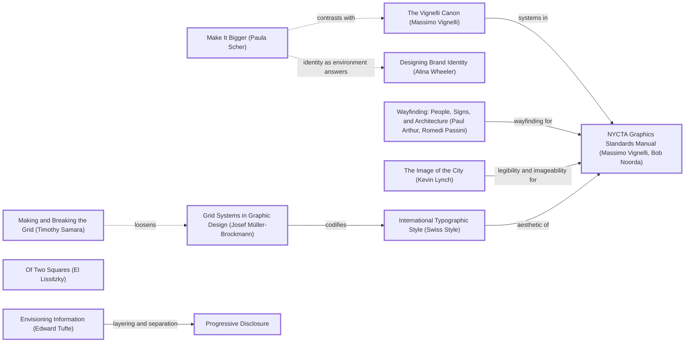
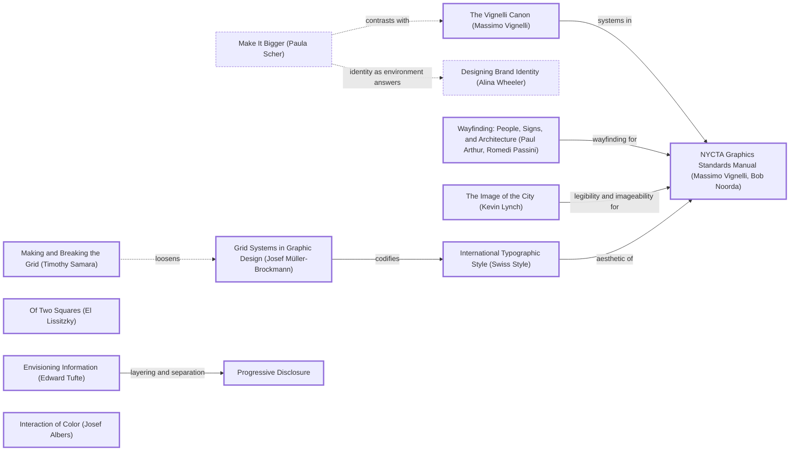

# DESIGN-LOG: Internet Structure redesign (DADA run, 2026-11-11)

## 1. Traversal Plan

**Brief, restated.** Overhaul the Internet Structure site so it looks far better, and make it as fast as possible on Next.js. (The inherited site was already Next.js 16 App Router, but it was a one-route client-side D3 app: the speed work is moving everything to build-time static HTML.)

**Mode: Adaptive.** The site serves a public audience (people trying to understand who runs the internet), so MAYA governs: the advanced pole (a poster-like cross-section with a single argued red line) and the acceptable pole (plain labels, a stated purpose, conventional navigation) must both hold.

**Run type: Full.** This is a redesign of the concept, structure and stack, so nothing is frozen. The Landing procedure runs inside it as the landing move (M3).

**Bound:** none stated by the person.

**Tooling inventory (Step 0).**

| Job | Tool used |
|---|---|
| Render and navigate the anchor graph | none available (no Mermaid renderer or graph DB in this session); the marked Mermaid text is kept in this log |
| Compute the Frontier | by hand from the edge lines of `references/anchor-graph.md` (grep) |
| Track workflow state | this log (checklist); no task tool used |
| Run the panel | Agent tool, one sub-agent per reference, at most three at a time, each filing to `design/panel/<round>/<seat>.md` |
| Collect panel reports | `scripts/collect_panel.py` |
| Choose the panel | `scripts/pick_panel.py --mode adaptive --run-type full --project internet_structure --data-graphic` |
| Brief each seat | the seat files in `seats/` (prompt template, trimmed to the evidence pointer) |
| Measure the artifact | Playwright (Chromium) via `design/measure.cjs` and screenshot scripts; `node --test` |
| Record the run | not done: the dada ledger repository is not attached to this session (see Compliance) |

**Seed (labels copied verbatim from the graph).**

- Stance: `Make It Bigger (Paula Scher)`
- Rules: `Grid Systems in Graphic Design (Josef Müller-Brockmann)` -->|codifies| `International Typographic Style (Swiss Style)` -->|aesthetic of| `NYCTA Graphics Standards Manual (Massimo Vignelli, Bob Noorda)`; and `Envisioning Information (Edward Tufte)` -->|layering and separation| `Progressive Disclosure`
- Breaker: `Of Two Squares (El Lissitzky)`
- Counterpoint: `The Vignelli Canon (Massimo Vignelli)`, reached by the dotted edge `Make It Bigger (Paula Scher)` -.->|contrasts with| `The Vignelli Canon (Massimo Vignelli)`

Chain: Make It Bigger -.->|contrasts with| The Vignelli Canon -->|systems in| NYCTA Graphics Standards Manual <--|aesthetic of| International Typographic Style <--|codifies| Grid Systems in Graphic Design; Envisioning Information -->|layering and separation| Progressive Disclosure; Breaker Of Two Squares (the red diagonal that cuts the grid).

**Panel (from `pick_panel.py`, copied with its reasons).**

| Seat | Why | File |
|---|---|---|
| Critic: Provocateur (Debord) | required by the adaptive panel minimum | `seats/crit_prov_debord.md` |
| Critic: Provocateur (Shklovsky) | required by the adaptive panel minimum | `seats/crit_prov_shklovsky.md` |
| Critic: Inclusion (Holmes) | required by the adaptive panel minimum | `seats/crit_inc_holmes.md` |
| Critic: Inclusion (Mace) | required by the adaptive panel minimum | `seats/crit_inc_mace.md` |
| Critic: Evidence (Cairo) | required: inspectable artifact, measurement seat from R0 | `seats/crit_evid_cairo.md` |
| Critic: Evidence (Tufte) | required: a data graphic gets the instrumentation seat | `seats/crit_evid_tufte.md` |
| Critic: Usability (Krug) | rated 0.844 over 65 rounds | `seats/crit_use_krug.md` |
| Critic: Dionysian Excess (Nietzsche) | rotation seat, 0 rounds on record | `seats/crit_dionys_nietzsche.md` |

Dotted pairs: Debord -.- Krug, Shklovsky -.- Krug. Content-owner witness: none separate. The data owner is the repository itself, and every figure is computed from `data/`.

**Override, R0 only:** R0 seated three of the eight (Cairo, Krug, Debord), because the inherited artifact was one screen and those three seats cover measurement, first use and the claim. This is a deviation from a full premortem panel, recorded here.

### Landing inventory (Landing procedure, step 1)

| Topic / page | Stands for it on the first screen |
|---|---|
| 7 strata (Serve, Govern, Name, Carry, Meet, Wire, Make) | one band each, with its numeral, name, count and one dot per organisation |
| 253 organisation pages | the 253 dots |
| The atlas | the bands are its rows; the red line is a path through it |
| How it works | the red line is one request's dependency chain |
| History (11 dossiers) | the bedrock band: a time axis 1877 to 2000 with one tick per dossier |
| About | figures computed from data; caption states the encoding |

### Initial Frontier

| Candidate | Reached via (edge label, direction) | From anchor | Status |
|---|---|---|---|
| R0 objections (Cairo F1-F7, Krug F1-F8, Debord F1-F7) | premortem | — | TAKEN (M1-M9) |
| Wayfinding locator on inner pages | arthur -->\|wayfinding for\| nycta (incoming) | NYCTA Graphics Standards Manual | TAKEN (M7) |
| Legibility / imageability of the cross-section | lynch -->\|legibility and imageability for\| nycta (incoming) | NYCTA Graphics Standards Manual | TAKEN (M3, M6) |
| Calm default with density one click away | tufteE -->\|layering and separation\| c_prog | Envisioning Information | TAKEN (M6) |
| Break the grid with one diagonal | samBreak -.->\|loosens\| mb (dotted, incoming) | Grid Systems | TAKEN (M4) |
| Identity as environment | scher -.->\|identity as environment answers\| wheeler (dotted) | Make It Bigger | TAKEN (M5) |
| Restraint on inner pages vs bigness on landing | scher -.->\|contrasts with\| vignelliCanon (dotted) | Make It Bigger | TAKEN (M7) |
| Proportion for the grid | elamGeo -->\|proportion for\| mb (incoming) | Grid Systems | DEFERRED: band heights are set by data (count), not by a proportional system; a golden-section grid would distort the encoding |
| Typographic revolution | lissitzky -->\|typographic revolution for\| newtypo | Of Two Squares | DEFERRED: the type is already asymmetric and condensed; a further typographic rupture would compete with the red line, which is the run's single Breaker |

## 2. Panel R0 (premortem on the inherited site)

### Panel, WHOLE, round R0 (artifact examined: main @ 5759ba9; `design/shots/r0__1280.png`, `r0__375.png`; evidence `design/panel/R0/evidence.md`)

| Critic | Anchor used | Observed in the work | Verdict PASS/OBJECT | Requested change |
|---|---|---|---|---|
| Critic: Evidence (Cairo) | The Truthful Art / How Charts Lie: encodings must be readable and checkable | about 20 colours with a 1-entry legend; labels 3-7 px; 231 unexplained unresolved refs; force position implies meaning; 12 dossiers unshown, 4 invalid JSON; spinner-only HTML | OBJECT | collapse to 8 or fewer categories with a full legend; legible labels; explain or fix the gaps; position that encodes something; show the dossiers; real HTML on first load |
| Critic: Usability (Krug) | Don't Make Me Think: five-second test | no purpose statement; next action in 8-9 px grey; dots don't read as clickable; builder jargon ("NODE INTELLIGENCE", "NETWORK READY"); 375 controls clipped | OBJECT | one sentence of purpose plus an obvious first action; 11-12 px labels; real legend; strip the jargon; fix 375 |
| Critic: Provocateur (Debord) | Society of the Spectacle: the spectacle as image substituting for relation | a monitoring dashboard of nothing monitored ("NETWORK READY"); no thesis; hairball as contemplation; dossiers hidden | OBJECT | a stated claim about who holds the network up; few named nodes and one argued path; delete status badges and decorative tiles; surface the dossiers |

Statements of meaning: the inherited site says "here is a lot of internet"; it does not say what the visitor should conclude.
Artist questions: can a single figure carry all six of the site's topics? Is a force layout ever truthful here?
Critic questions: what does position mean; why are the dossiers in the repo but not on the site?
Opinions: unanimous OBJECT.
Andon pulled: no.

### Resolutions, R0

| Finding | Resolution |
|---|---|
| Cairo + Krug + Debord: (Cairo F1, Krug F4, Debord F4) ~20 colours, 1-entry legend | ADAPT (M2, M3): 52 layer tags folded into 7 strata; strata encoded by position and labelled directly; colour reduced to ink plus one red |
| Cairo + Krug + Debord: (Cairo F2, Krug F3, Debord F3) labels 3-7 px | ADAPT (M3, M6): landing figure drawn at 1:1 in two sizes, smallest SVG label 12 px at 375; atlas labels held at 12.5 screen px at any zoom, collision-culled |
| Cairo + Debord: (Cairo F3, Debord F6) unresolved references paraded | ADAPT (M2, M8): 49 references repaired (spelling and alias), 181 remaining listed by name on /about with the reason; removed from the chrome |
| Cairo: (Cairo F4) force position implies meaning | ADAPT (M6): atlas y is stratum (hard-clamped bands); the page states that x carries no meaning |
| Cairo + Debord + Krug: (Cairo F5, Debord F7, Krug F5) stat tiles and builder jargon | ADAPT (M3, M5): tiles, status pills and jargon deleted; counts appear only as answers in sentences |
| Cairo + Krug + Debord: (Cairo F6, Krug F8, Debord F5) dossiers hidden; 4 invalid JSON | ADAPT (M1, M7): JSON repaired; 11 dossier pages plus a how-it-works page |
| Cairo + Debord: (Cairo F7, Debord F5) spinner HTML, 652 KB JS | ADAPT (M9): everything pre-rendered; d3 removed from the client |
| Krug + Debord: (Krug F1-F2, Debord F2) no claim, no first action | ADAPT (M3): headline claim "No one owns the internet. 253 organisations hold it up."; two buttons |
| Krug: (Krug F6) clipped controls at 375 | ADAPT (M5, M6): navigation wraps; atlas search full width |
| Krug: (Krug F7) the empty state was clear | KEEP: the atlas panel keeps an empty-state instruction ("Pick a dot") |

## 3. Decision Records

> Honesty note: M1 to M9 were written during the build, interleaved with the work, not each strictly before its move. The content is what drove each move, but the "record before move" rule was not met to the letter. M10 onward were written before the move.

## Move M1: Repair the data and merge duplicates  (KEEP-THE-RULE)
Depends on: none
Anchors: Rule `Envisioning Information (Edward Tufte)` (truthful layering starts from clean data) | Critic finding Cairo R0 F6
Intent: every file in `data/` parses; one id = one organisation.
Formal argument: Claim: the site cannot show dossiers that do not parse, or count organisations twice. Grounds: 4 of 13 files were invalid (unescaped quotes in `:chatgpt-content-reference{index="1"}`, one stray quote after `1995`); 21 ids occur twice. Warrant: a figure that counts duplicate records misstates the population it encodes.
Alternatives rejected: (a) strip the citation tokens from the source, rejected because it edits content, where escaping only repairs syntax; (b) drop the second record of each duplicate, rejected because it loses connections.
Consequence: 274 records become 253 organisations; the headline figure is 253, not 274.
Fence: none broken.
Frontier effect: opens M7 (dossier pages) and M2.
Mode field: Advanced pole — none (hygiene). Acceptable pole — Cairo F6.

## Move M2: Fold 52 layer tags into seven strata  (KEEP-THE-RULE)
Depends on: M1
Anchors: Rule `Grid Systems in Graphic Design (Josef Müller-Brockmann)` | Rule `International Typographic Style (Swiss Style)` | `NYCTA Graphics Standards Manual (Massimo Vignelli, Bob Noorda)` (a system of few, named lines)
Intent: replace colour-coded chaos with seven named, ordered rows: Serve, Govern, Name, Carry, Meet, Wire, Make.
Formal argument: Claim: seven ordered strata can be read by position alone. Grounds: 52 tags, 20+ colours, a 1-entry legend (R0). Warrant: Müller-Brockmann's grid and Vignelli's subway system both encode by position and name, not hue.
Alternatives rejected: (a) 8-colour legend: still requires lookup; (b) keep 52 tags with a search: does not answer "what is this".
Consequence: a mapping decision must be defended: `lib/strata.js` plus a test that fails on any unmapped tag; one type override (DNS/registry to Name) is disclosed on /about.
Fence: none.
Frontier effect: M3, M6.
Mode field: Advanced — strata as geology (bedrock = history). Acceptable — plain names and a question per stratum.

## Move M3: Landing cross-section, all topics on one figure  (BREAK)
Depends on: M2
Anchors: Stance `Make It Bigger (Paula Scher)` | Rule `Grid Systems in Graphic Design (Josef Müller-Brockmann)` | `The Image of the City (Kevin Lynch)` (legibility, imageability)
Intent: the first screen is one composed figure: 7 bands (numeral, name, count, one dot per organisation) plus a bedrock time axis of the 11 dossiers; headline states the claim.
Formal argument: Claim: one figure can summarize every page of the site. Grounds: inventory table above; 253 dots + 11 ticks. Warrant: Scher's scale gives the claim force; the grid keeps it readable.
Alternatives rejected: (a) six cards in a row, which is not a form; (b) the full force atlas as hero, which fails the legibility probe (R0).
Consequence: the HTML carries two SVGs (wide and narrow, drawn 1:1); 154 KB raw, 23 KB gzip.
Fence: breaks the convention that a hero is a photo plus a headline. That convention exists to give one focal point; the red line provides it.
Frontier effect: M4, the legibility probe, S4.
Mode field: Advanced — stratigraphic poster. Acceptable — plain claim, two buttons, labels at 12 px or more.

## Move M4: The red line  (BREAK)
Depends on: M3
Anchors: Breaker `Of Two Squares (El Lissitzky)` | Counterpoint `Making and Breaking the Grid (Timothy Samara)` (-.->|loosens| Grid Systems)
Intent: one red polyline through recorded connections, one stop per stratum: 1 Comcast, 2 Equinix, 3 Grace Hopper, 4 Google, 5 Verisign, 6 ICANN, with a dashed branch Google, NVIDIA, TSMC. It is the only red mark on an ink-and-paper grid, cutting diagonally across it.
Formal argument: Claim: the internet's structure is dependency across layers. Grounds: every step is a link in `data/internet.json` (test enforced). Warrant: Lissitzky's red wedge makes the argument with one colour and one diagonal.
Alternatives rejected: (a) a traceroute-style animated packet, which would be invented, not recorded; (b) a monotone top-to-bottom path, which no real chain in the data supports.
Consequence: the line jumps from Wire up to Serve: a long diagonal. Accepted; it is the point.
Fence: breaks the grid's orthogonality. The grid exists to make comparison easy; the line is the one element that is not compared, it is argued.
Frontier effect: route section "Follow the red line" with links to each stop.
Mode field: Advanced — Constructivist diagonal. Acceptable — numbered, named stops.

## Move M5: Identity as environment: paper, ink, one red; Archivo  (KEEP-THE-RULE)
Depends on: M3
Anchors: `Designing Brand Identity (Alina Wheeler)` via dotted edge from `Make It Bigger (Paula Scher)` | `International Typographic Style (Swiss Style)`
Intent: replace the zinc dashboard with paper (#f2efe7), ink (#121110) and signal red (#c8150b); one self-hosted variable font (Archivo, wdth 62 for display, 100 for text; 90 KB, preloaded by next/font); a skewed red bar mark; dark mode tokens.
Formal argument: the red is reserved for the argument (route, current stratum, history ticks), so it carries meaning everywhere.
Alternatives rejected: (a) system fonts only, which saves 90 KB but loses the condensed display voice; (b) a Google Fonts call, an extra origin that would fail offline builds.
Consequence: +90 KB font, once, cached.
Fence: none.
Frontier effect: M7.
Mode field: Advanced — poster type. Acceptable — 17 px body, contrast at or above 4.5:1 everywhere (measured).

## Move M6: Stratified, pre-computed atlas  (KEEP-THE-RULE)
Depends on: M2
Anchors: `Envisioning Information (Edward Tufte)` -->|layering and separation| `Progressive Disclosure`
Intent: the map keeps every organisation inside its stratum band (y = stratum); d3-force runs at build time; the browser receives finished SVG; selection lights neighbours in red and labels them without collisions; calm default (40 collision-free labels).
Alternatives rejected: (a) client-side simulation, which was slow and non-deterministic (R0); (b) an adjacency matrix, which is truthful but unreadable at 253 x 253 on a phone.
Consequence: atlas HTML 356 KB raw / 54 KB gzip; no d3 in the client.
Fence: none.
Mode field: Advanced — the atlas as a cross-section, matching the hero. Acceptable — search, list fallback, Escape, zoom buttons.

## Move M7: Multi-page site under one navigation  (KEEP-THE-RULE)
Depends on: M1, M2, M5
Anchors: `Wayfinding: People, Signs, and Architecture (Paul Arthur, Romedi Passini)` -->|wayfinding for| NYCTA | Counterpoint `The Vignelli Canon (Massimo Vignelli)`: inner pages are restrained (grid, tables, rules) where the landing is big
Intent: 283 static pages: /, /atlas, /strata plus 7 stratum pages, /organisations plus 253 profiles, /history plus 11 dossiers, /how-it-works, /about; a seven-cell stratum locator on inner pages.
Alternatives rejected: (a) a single long page, which breaks the multi-page rule; (b) client-side routing with data fetching, which is slower.
Mode field: Advanced — the locator strip. Acceptable — breadcrumbs, A to Z.

## Move M8: Disclose the data's gaps on /about  (KEEP-THE-RULE)
Depends on: M1, M2
Anchors: Cairo R0 F3; `Envisioning Information (Edward Tufte)`
Intent: repaired (49), unresolved (181, listed), merged (21) and overridden (2) records named with reasons, instead of a footer counter.

## Move M9: Speed: static HTML, no client d3, no runtime fetch  (KEEP-THE-RULE)
Depends on: M3, M6, M7
Anchors: `Ten Principles of Good Design (Dieter Rams)` ("as little design as possible": nothing runs that need not)
Intent: every page is pre-rendered (`dynamicParams = false`); data is read at build time by server components; the only client component is the atlas interaction.
Residual diff (measured): client JS 652,567 B raw (R0) to 469,118 B raw (176 KB gzip, the Next/React runtime only); landing HTML 8,828 B with a spinner to 154,591 B (23 KB gzip) containing the full figure; 1 route to 283 static pages; time to `load` locally 1,605 ms to 118 ms (networkidle and load are not identical measures; R0 waited for networkidle).

## 4. Panel R1 (WHOLE, on M1-M9)

### Panel, WHOLE, round R1 (artifact examined: build of commit 117e4fd; `design/shots/R1/`; evidence `design/panel/R1/evidence.md`, raw `design/panel/measure-R1.json`)

All 8 seats filed (`collect_panel.py`: 8 of 8 REPORTED). Full texts: `design/panel/R1/<seat>.md`.

| Critic | Anchor used | Observed in the work | Verdict PASS/OBJECT | Requested change |
|---|---|---|---|---|
| Critic: Evidence (Cairo) | The Truthful Art: each channel means one stated thing | re-ran counts from `data/` (274/253/21/52/691/181 match; repaired 50 vs 49 printed); route dots drawn larger than their importance; 224 of 253 score 8-10 so size barely varies; x = fill order, undisclosed on landing | OBJECT | true radius or drop size; key inside the figure; disclose x, the Verisign rule, the dataset's limits; counting rules on /about |
| Critic: Evidence (Tufte) | Visual Display: lie factor, small multiples, data-ink | per-page bar scales on /strata/[id]; self-links set the scale; radius linear in score (lie factor ~0.4); ROUTE_X scripted; red history ticks unlabelled; atlas band labels faint | OBJECT | one shared scale; self-links apart; area-true size; ticks in ink with year marks; caption on route x; darker band labels; consider a crossings matrix |
| Critic: Usability (Krug) | Don't Make Me Think: five-second test | legibility probe PASS at 1280; at 375 no first action above the fold; stratum numerals 1-7 and route steps 1-6 collide; history labels overlap at 375; bands not signed as links | OBJECT | button under the h1 at 375; badge the route numbers; fix the collision; link cue on bands |
| Critic: Provocateur (Debord) | Society of the Spectacle: claim and prove | "No one owns" is unargued and contradicts "owners" kicker; 253 is a count, not a finding; dot size invisible; route authored; gaps hidden on /about | OBJECT | one claim the figure proves (show what concentrates); fix size caption; disclose chosen route and gaps beside the figure |
| Critic: Provocateur (Shklovsky) | Art as Device: defamiliarization | uniform grey rows read as a familiar dot chart; inner pages are the stock template; atlas is the habitual hairball; headline is a cliché; 375 label collision | OBJECT | one device carried through every page (bands weighted by count, reused on subpages); fix collision |
| Critic: Inclusion (Holmes) | Mismatch: recognize exclusion | probes clean; atlas nodes not focusable; Enter takes the first match only; selection by colour and opacity; 375 label collision | OBJECT | stagger labels; 14 px SVG floor; A-Z above the map; search results list with arrows; non-colour cue for connected nodes |
| Critic: Inclusion (Mace) | Universal Design P2, P3, P5, P7 | real-Tab focus visible on links, buttons and bands; after choosing a neighbour focus drops to BODY; nodes unreachable by keyboard; history tick links 6 x 17 px; duplicate "Charter Spectrum" | OBJECT | move focus to the panel heading; listbox search; 24 px hit area or a list alternative for ticks; disambiguate duplicates |
| Critic: Dionysian Excess (Nietzsche) | The Birth of Tragedy | the Apollonian is complete and the Dionysian is one red line; 253 dots are the palest marks; equal band heights flatten Carry (77) against Serve (11) | OBJECT | let the multitude swell: band height or density by count, darker dots, the red line cutting through a saturated field |

Statements of meaning: the R1 site says "the internet is layered, and here is one path through the layers"; seats agree the path is legible and the data honest, and disagree on whether the figure argues anything.
Artist questions: can a claim be found in the data that the figure itself proves? Is size worth keeping at all?
Critic questions: what does x mean on the landing; why is the History band red; what does "no one owns" rest on?
Opinions: 8 OBJECT. Sharpest disagreement: Krug and Holmes want quieter and clearer; Nietzsche and Shklovsky want louder and heavier. Resolved by one move that serves both (M10: weight comes from data, not ornament).
Andon pulled: no.

### Frame swap (Step 2d)

Five seats (Cairo F1-F2, Tufte F3, Debord F3, Shklovsky F1, Nietzsche F2) objected to the same region: the uniform pale dot field and its "size = importance" encoding. That region is swapped: the size channel is SCRAPPED, every dot is one size, and the field's weight now comes from two data-driven sources, band height by number of rows (Nietzsche, Shklovsky) and ink for hubs (Debord's "show what concentrates"). Anchor: replaced `Make It Bigger (Paula Scher)`'s literal bigness of headline with bigness of mass in the figure, reached through the existing edge Make It Bigger -.->|contrasts with| The Vignelli Canon (system: one dot, one meaning).

## Move M10: Measured claim and the hub device  (BREAK)
Depends on: M3, M4 (REOPENED by R1)
Anchors: Stance `Make It Bigger (Paula Scher)` | Counterpoint `The Vignelli Canon (Massimo Vignelli)` | Debord R1 F1-F2
Intent: replace the slogan "No one owns the internet" with a figure computed from the data, "253 organisations hold the internet up. 43 of them hold half of it.", and make the figure prove it: the 43 hubs drawn in ink, the rest in grey, hubs packed first in each band.
Formal argument: Claim: concentration is the structural fact the data supports. Grounds: ranked by recorded connections, the top 43 of 253 (17 %) account for 696 of 1,382 link endpoints and touch 594 of 691 links (`lib/data.js`, test-asserted as the minimal such set). Warrant: Debord's demand that the image prove a relation; Cairo's one channel, one meaning.
Alternatives rejected: (a) keep "no one owns": unfalsifiable from this data (no ownership field); (b) "the internet has seven layers": true but a taxonomy, not a finding; (c) top-10 share: 10 hubs hold 35 %, a weaker and more arbitrary cut than "half".
Consequence: the headline grows to two sentences; at 1280 it runs six lines in the left column. Checked against the fold: union bottom 656 px.
Fence: none.
Frontier effect: hub device reused in atlas (M12), stratum pages (hub tag, hub count), organisation pages, the stratum strip carries counts.
Mode field: Advanced: the figure states a finding, ink against grey. Acceptable: a sentence a non-specialist can repeat.

## Move M11: Figure honesty pass  (KEEP-THE-RULE)
Depends on: M10
Anchors: `Envisioning Information (Edward Tufte)` | Cairo R1 F1-F8 | Tufte R1 F1-F5
Intent: uniform dots (size channel scrapped); band height = rows needed (Carry tallest, test-asserted); route marked by a red ring, not a bigger dot; route steps as red numbered badges (Krug F2); history ticks in ink with quarter-century year marks, labels clear of stacks; in-figure key above the SVG (hub / other / red chain); caption: "position along a band means nothing", "Verisign counts as Name by its type", link to About; /strata/[id] bars on one scale shared by all seven pages (max off-diagonal crossing = 122), self-links reported apart; /strata gains a 7 x 7 crossings table with one-scale bars; /about gains "How each number is counted".
Alternatives rejected: area-true radius for importance (Tufte): with 224 of 253 scores at 8-10 the channel would still be near-invisible, so it was dropped rather than corrected; ticks as individual links with 24 px hit areas (Mace): eleven ticks within 123 years on a 255 px axis cannot each have 24 px without overlap, so the whole band links to the /history list instead (list alternative).
Consequence: a reader loses importance on the landing; it remains on every organisation page.

## Move M12: Atlas access and the hub device  (KEEP-THE-RULE)
Depends on: M6, M10
Anchors: `Progressive Disclosure` | Holmes R1 F3-F6 | Mace R1 F1-F5
Intent: search is a combobox with an arrow-key listbox; choosing from the list or a neighbour moves focus to the panel heading; "Clear selection" control; A-Z list offered above the map; connected nodes gain an ink stroke (non-colour cue), the selected node a heavier one; hubs in ink; band labels in muted ink (not 16 % opacity); edges lighter; duplicate names disambiguated by type ("Charter Spectrum (ISP)").

### Resolutions, R1

| Finding | Resolution |
|---|---|
| Krug + Holmes + Shklovsky + Nietzsche: (Krug F3, Holmes F1, Shklovsky F6, Nietzsche F5) history labels collide at 375 | ADAPT (M11): an earlier CSS fix had been inert (the rule was pasted outside its media query; measured: label still rendered). Fixed and re-measured; first-tick label hidden at <=760 px and the ARPANET label raised above the tick stacks |
| Cairo + Tufte + Debord + Shklovsky + Nietzsche: (Cairo F1, Cairo F2, Tufte F3, Debord F3, Shklovsky F1, Nietzsche F2) size channel misdrawn or invisible; dot field inert | ADAPT (frame swap, M10-M11): size scrapped; hubs in ink; band height by rows |
| Nietzsche + Shklovsky (request): (Nietzsche F3, Shklovsky (request)) equal band heights | ADAPT (M11): Carry 81 px vs Serve 49 px at 1280 (test asserts Carry is tallest) |
| Debord + Shklovsky: (Debord F1, Shklovsky F4) slogan headline | ADAPT (M10): measured claim |
| Debord: (Debord F2) 253 is a count, not a finding | ADAPT (M10) |
| Cairo + Tufte + Debord: (Cairo F3, Tufte F4, Debord F4) route x scripted, undisclosed | ADAPT (M11): caption "position along a band means nothing"; /about "picked by hand ... chosen for legibility" |
| Cairo + Tufte: (Cairo F4, Tufte F5) red used for ticks and route | ADAPT (M11): ticks in ink, red reserved for the chain and the arrows |
| Cairo: (Cairo F5) Verisign rule only on /about | ADAPT (M11): in the caption |
| Cairo + Debord: (Cairo F6, Debord F5) dataset presented as the whole; gaps on /about only | ADAPT (M10-M11): lede says "in this dataset"; second CTA "What the data leaves out" links /about#gaps beside the hero |
| Cairo: (Cairo F7) counting procedure missing | ADAPT (M11): /about#counting, one rule per number |
| Cairo: (Cairo F8) years mean different things | ADAPT: /history lists what each year marks ("1969: established"); landing ticks carry no claim beyond position on the axis |
| Tufte + F2: (Tufte F1, F2) per-page bar scales; self-links dominate | ADAPT (M11) |
| Tufte: (Tufte F6) x inside band is fill order | ADAPT (M11): caption |
| Tufte: (Tufte F7) atlas band labels faint; equal edges | ADAPT (M12) |
| Tufte: (Tufte F8 [premise]) force layout a poor encoding; prefer matrix | ADAPT in part (M11): the 7 x 7 matrix added on /strata; OVERRULE for the atlas itself (Adaptive, acceptable pole): the stratified map is the one place a visitor can follow a single organisation's links, which a 253 x 253 matrix cannot offer on a phone |
| Krug: (Krug F1) no first action above the fold at 375 | ADAPT (M10): "Explore the atlas" button under the h1 at <=640 px |
| Krug: (Krug F2) two numbering systems | ADAPT (M11): route steps in red badges |
| Krug + Holmes: (Krug F4, Holmes F5) bands not signed as links | ADAPT (M11): red arrow after every band name |
| Krug: (Krug F5 [claim]) one-word stratum names need learning | OVERRULE (MAYA advanced pole): every name is paired with its plain subtitle at 1280 and on every stratum card; at 375 the count replaces it for space, and the names are verbs a visitor can guess |
| Krug: (Krug F6) dashed branch unexplained at 375 | ADAPT (M11): key "one chain of recorded links"; the lede below the figure names NVIDIA and TSMC |
| Holmes: (Holmes F2) SVG text floor 14 px at 375 | ADAPT in part: route labels 12.5 px, counts and years 12 px at 375 (were 11-11.5); OVERRULE for 14 px: the 375 figure would no longer fit the first screen (First screen rule), and 12 px meets no failing criterion |
| Holmes + Mace: (Holmes F3, Mace F2) map nodes not keyboard-reachable | ADAPT (M12): listbox search, focus to panel, A-Z above the map; nodes themselves stay pointer targets (253 tab stops would be worse) |
| Holmes: (Holmes F4) Enter takes only the first match | OVERRULE (premise partly refuted: the R1 panel already listed up to 12 matches as buttons when nothing is selected) and ADAPT anyway (M12): arrow-key listbox |
| Holmes: (Holmes F6) selection by colour only | ADAPT (M12): ink stroke on connected nodes, heavier on the selected |
| Mace: (Mace F1) focus drops to BODY | ADAPT (M12) |
| Mace: (Mace F3) tick links 6 px wide | ADAPT (M11): ticks are no longer separate links; the whole band (720 x 76 px at 1280) links to the /history list |
| Mace: (Mace F5) duplicate "Charter Spectrum" | ADAPT (M12): disambiguated by type in the atlas (7 name pairs in the data) |
| Shklovsky: (Shklovsky F2) inner pages are the stock template | ADAPT in part (M10-M11): the hub device and counts run through the stratum strip, stratum tables (hub tags) and organisation facts; OVERRULE for a new device per inner page (Adaptive: inner pages are reference, and Vignelli's counterpoint keeps them restrained) |
| Shklovsky + Nietzsche + Debord: (Shklovsky F3, Nietzsche F6, Debord F7) atlas x meaningless | OVERRULE (premise is disclosed, not hidden): the page states x is not a measurement; y is. The matrix now carries the measured view |
| Shklovsky: (Shklovsky F5) palette is the tasteful kit | OVERRULE (Adaptive criterion): paper, ink and one red keep red meaning "the argument" everywhere; a louder palette would cost the single-signal rule |
| Debord: (Debord F6) History band unrelated to strata | OVERRULE (MAYA): it is labelled bedrock, sits below Make, and links to its own index; the relation is chronological, not structural, and the page does not claim otherwise |
| Mace: (Mace F4 [claim]) evidence's focus line was narrow | ADAPT: R2 evidence reports bands, buttons and atlas controls |

Dependents REOPENED by R1: M3 (hero composition), M4 (route marks), M6 (atlas styling). All three re-rendered and re-measured before R2.

## 5. Panel R2 (WHOLE, on M10-M12)

Artifact: build after M12 (`design/shots/R2/`, evidence `design/panel/R2/evidence.md`, raw `design/panel/measure-R2.json`). Seats filed: 6 of 8. Mace and Nietzsche were not convened on R2: the owner's feedback (below) arrived mid-round and changed the artifact, so both sat R3 on the new state instead. Debord's R2 file was transcribed verbatim from the returned text because the seat had no write tool (marked in the file).

| Critic | Anchor used | Observed in the work | Verdict PASS/OBJECT | Requested change |
|---|---|---|---|---|
| Critic: Evidence (Cairo) | The Truthful Art | reproduced 43 from `data/` independently; route, size, caption and /about fixes landed; lede says "hold half of all 691 connections", which is really half of endpoints | PASS | reword the lede; disclose tie-break |
| Critic: Evidence (Tufte) | Visual Display | stratum-page bars render 0 px wide (inline span inside the new track) | OBJECT | `display:block`, re-measure |
| Critic: Usability (Krug) | Don't Make Me Think | legibility probe passes at both widths; button under h1 at 375; badges, arrows, collision fixed | PASS | optional: shorter lede |
| Critic: Provocateur (Debord) | Society of the Spectacle | headline phrase "43 of them..." in red, while red means the route | OBJECT | ink headline; red only for route |
| Critic: Provocateur (Shklovsky) | Art as Device | band weight and ink hubs make the count seen; inner pages remain template (accepted) | PASS | optional |
| Critic: Inclusion (Holmes) | Mismatch | label collision fixed; listbox, focus, A-Z, ink stroke all observed | PASS | optional: reduced-edge atlas at 375 |

Andon: no. Resolutions: Tufte "bars 0 px" ADAPT (M13a: `display:block`; R3 measured 176.7 px for 122/122). Debord "red headline" ADAPT (M13: ink headline with a data bar). Cairo wording ADAPT (lede "connection ends ... touch 594 of 691"; /about tie-break and "hold = recorded connections, not traffic or ownership").

### Owner feedback (between R2 and R3)

> "Very very good design A would be a plus but colors are just a bit too similar add rule to dada and dada chnages to always choose colors for site dynamically based on site topic mix up colors a bit and add to portfolio anew"

### Resolutions, R2

| Finding | Resolution |
|---|---|
| Tufte: stratum-page bars render 0 px | ADAPT (M13a): `.bar` display:block; R3 measured 176.7 px for 122 of 122 |
| Debord: red headline phrase competes with the red route | ADAPT (M13): headline in ink with a data underline |
| Cairo: lede says half of connections, means half of endpoints; tie-break undisclosed | ADAPT: lede and /about#counting reworded |
| Holmes: reduced-edge atlas at 375 (optional) | DEFERRED: search, A-Z and Clear selection give an equal route |

## Move M13: Palette from the topic (TIA-598 fibre colours)  (BREAK, escalating M5)
Depends on: M5, M10, M11 (all REOPENED by the owner)
Anchors: `Designing Brand Identity (Alina Wheeler)` (identity as environment), `Interaction of Color (Josef Albers)`, `WCAG 2.2 Contrast and Perceivability (W3C)`
Intent: one hue per stratum, taken from the colour code inside every fibre cable: Make brown, Wire blue, Meet green, Carry orange, Name yellow, Govern violet, Serve aqua; red (fibre 7) stays the route. Hubs filled, others ringed (shape, not tint).
Formal argument: Claim: colour should come from the subject, and should separate what the site separates. Grounds: the owner's "colors are just a bit too similar"; R2 had ink, grey and one red for seven strata. Warrant: Wheeler's identity-as-environment; Albers' relativity, checked by measurement, not by eye.
Alternatives rejected: (a) a generic categorical palette (Tableau 10), which has no relation to the topic; (b) pale tints for non-hubs, measured at 1.6-2.1:1 against paper, too faint.
Consequence: min CIE76 ΔE 31 between any two of 8 hues (light), 35 (dark); contrast 3.28-7.19:1 light, 6.1-10.7:1 dark. Under deuteranopia Carry and Name approach (simulated ΔE 3.6, Cairo and Holmes R3), so every colour fact keeps a non-colour twin (numeral, label, position, fill vs ring).
Measured delta: distinct hues in the landing figure 2 (ink, grey) + red, now 7 + red.

## 6. Panel R3 (WHOLE, on M13)

Artifact: `design/shots/R3/`, evidence `design/panel/R3/evidence.md`, raw `design/panel/measure-R3.json`. 8 of 8 filed.

| Critic | Anchor used | Observed in the work | Verdict PASS/OBJECT | Requested change |
|---|---|---|---|---|
| Critic: Evidence (Cairo) | The Truthful Art | key matches marks; R2 wording landed; CVD simulation: Carry/Name ΔE 3.6 (deutan) but redundantly encoded | PASS | optional: shift Name or Carry |
| Critic: Evidence (Tufte) | Visual Display | bars now to scale (rendered/track = count/122 within 0.1 px); colour layering does no harm; ribbons are non-data ink | PASS | optional: drop ribbon under "43" |
| Critic: Usability (Krug) | Don't Make Me Think | five-second test and legibility probe pass; colour adds no thinking | PASS | optional: shorter lede |
| Critic: Provocateur (Debord) | Society of the Spectacle | R2 defect fixed; but the 7-colour underline implies hubs in all 7 strata (Wire has none); sr-only text still says "ink" | OBJECT | data underline; fix description |
| Critic: Provocateur (Shklovsky) | Art as Device | hue separation answers the owner; strangeness documented but not perceived | PASS | optional: name TIA-598 in the key |
| Critic: Inclusion (Holmes) | Mismatch | every colour fact has a non-colour twin | PASS | optional |
| Critic: Inclusion (Mace) | Universal Design | real-Tab focus on bands and atlas; focus to heading; forced colours keep fill/ring; neighbour buttons 23 px | PASS | optional: 24 px |
| Critic: Dionysian Excess (Nietzsche) | Birth of Tragedy | saturated bands, weighted heights; colour carries force | PASS | optional: bigger hubs |

Andon: no. Resolutions: Debord "7-colour underline asserts hubs in Wire" ADAPT (M14: the underline is a stacked bar of the 43 hubs by stratum, computed; Wire absent). Debord "sr-only text stale" ADAPT. Mace "23 px buttons" ADAPT (24 px). Shklovsky "name the code" ADAPT (key: "fibre-cable colours (TIA-598)"). Krug "lede" ADAPT (about 60 words). Cairo + Holmes "Carry/Name under deuteranopia" OVERRULE (premise measured: both seats found no misreading, because numeral, label and band position carry the stratum; lightening Name would drop it below 3:1 on paper). Tufte "drop the ribbon under 43" made moot by M14. Nietzsche "bigger hubs" DEFERRED (fill vs ring already carries weight; bigger hubs would break the one-size rule that answered Tufte R1 F3).

### Resolutions, R3

| Finding | Resolution |
|---|---|
| Debord: 7-colour underline asserts hubs in Wire | ADAPT (M14): stacked bar of hubs by stratum, Wire absent |
| Debord: screen-reader description says ink | ADAPT: "drawn as filled dots ... the rest are rings" |
| Mace: neighbour buttons 23 px | ADAPT: min-height 24 px (R4 measured 24.0 px) |
| Shklovsky: name the colour code on the page | ADAPT: key reads "fibre-cable colours (TIA-598)" |
| Cairo + Holmes: Carry and Name close under deuteranopia | OVERRULE (premise refuted: both seats measured no misreading, since numeral, label and position carry stratum; a lighter Name would fall below 3:1) |
| Nietzsche: bigger hubs | DEFERRED: one dot size answers Tufte R1 F3 |

## Move M14: The headline underline as data; S4 push  (BREAK, escalation of M4/M10)
Depends on: M10, M13
Intent: the underline under "43 of them hold half of it" is a stacked bar of the hubs by stratum (Make 6, Meet 7, Carry 15, Name 7, Govern 3, Serve 5; Wire 0). S4: the Breaker (red line) pushed from 3 px to 4.2 px, rings 2.4 to 3 px, branch 2.2 to 3 px.
Measured delta: computed `stroke-width` 4.2px and 3px (Playwright, after the build). Bar stops 13.95 / 30.23 / 65.12 / 81.40 / 88.37 / 100 % = cumulative 6/13/28/35/38/43 of 43; rendered segment pixels within 0.3 points of the data (Cairo, Tufte R4).

## 7. Panel R4 (WHOLE, final state)

Artifact: `design/shots/R4/`, evidence `design/panel/R4/evidence.md`, raw `design/panel/measure-R4.json`.

| Critic | Anchor used | Observed in the work | Verdict PASS/OBJECT | Requested change |
|---|---|---|---|---|
| Critic: Evidence (Cairo) | The Truthful Art | bar widths equal hub counts within 0.3 points; Wire absent and stated | PASS | optional: one-line bar with counts |
| Critic: Evidence (Tufte) | Visual Display | lie factor ~1 for the bar; 4.2 px route separates from Carry orange | PASS | optional: one-line bar with counts |
| Critic: Usability (Krug) | Don't Make Me Think | probes pass; first action visible at both widths | PASS | optional: drop "(TIA-598)" |
| Critic: Provocateur (Debord) | Society of the Spectacle | R3 defects resolved; the bar is data, the description corrected | PASS | optional: print counts |
| Critic: Provocateur (Shklovsky) | Art as Device | the underline made to carry data is real roughening; the red chain cuts the field | PASS | none |
| Critic: Inclusion (Holmes) | Mismatch | every colour fact has a twin; buttons 24 px | PASS | optional: counts in the bar's accessible name |
| Critic: Dionysian Excess (Nietzsche) | Birth of Tragedy | the Breaker is the one unmistakable line; fill vs ring is weight | PASS | optional: bigger hubs |
| Critic: Inclusion (Mace) | Universal Design | real-Tab focus visible at every landing and atlas stop; listbox, heading focus and neighbour stepping complete; neighbour buttons 24.0 px | PASS | optional: CSS outline on band links |

Andon: no. R4 produced no ADAPT, SCRAP or REOPEN. Optional requests DEFERRED (none is a defect; Mace's band-outline note also deferred, since the 3 px focus stroke on the band's hit area is measured visible; each would reopen the first screen): one-line hub bar with printed counts (Cairo, Tufte, Debord, Holmes), drop "(TIA-598)" (Krug; Shklovsky asked for it, so the two seats cancel), bigger hubs (Nietzsche), reduced-edge atlas at 375 (Holmes).

## 7b. Owner regrade and move M15

> "A plus on that one for Greta desung despite poor colors vary and get bit more creative with colors of actual site put changes in dada changes repo on perosnl account"

Read as: A+ for great design despite poor colours; vary the colours and be more creative with them on the site.

## Move M15: Colour zones  (BREAK, escalation of M13)
Depends on: M13 (REOPENED by the owner)
Anchors: `Designing Brand Identity (Alina Wheeler)` (identity as environment), `Interaction of Color (Josef Albers)` (a hue changes with its ground)
Intent: the same fibre hues on different grounds per zone. The landing hero (and the landing header) is a night slab, the inside of a cable jacket (#0e1117 with a blue glow), so the hues run vivid. Each band in the figure gets a 15 % wash of its colour. Strata cards get a 9 % wash, and the two largest strata (Name, Carry) take double-width cards. Stratum and organisation pages open with a stratum-coloured header block. History pages and the landing's Bedrock section move to a copper and paper era palette.
Formal argument: Claim: the owner's "poor colors" was one palette on one paper ground, so variety must come from grounds, not new hues. Grounds: R4 site, A then A+ "despite poor colors". Warrant: Albers, colour is relative to its ground; Wheeler, identity as an environment the visitor moves through.
Alternatives rejected: (a) more hues, which would break one-hue-per-stratum; (b) a dark site throughout, which loses the light reading pages and the copper era contrast.
Consequence: zone contrast measured separately; the probe had to learn `color(srgb ...)` values (it misread tinted cards as 1.11:1; real contrast is about 6:1).
Measured delta: grounds on the site 1 (paper) became 4 (night, paper, stratum wash, copper). The band wash went from 8 % to 15 % after Shklovsky R5.

## 7c. Panel R5 (WHOLE, on M15) and R6 (confirmation)

| Critic | Anchor used | Observed in the work | Verdict PASS/OBJECT | Requested change |
|---|---|---|---|---|
| Critic: Evidence (Cairo) | The Truthful Art | colour still means stratum everywhere; zones add context; copper sits near Make brown but carries no stratum | PASS | optional |
| Critic: Inclusion (Holmes) | Mismatch | colour zones are decoration over text; every colour fact has a twin | PASS | optional |
| Critic: Provocateur (Shklovsky) | Art as Device | the night slab estranges; 8 % washes invisible on dark; equal cards a recoloured dashboard | PASS | optional: size by count |
| Critic: Usability (Krug) | Don't Make Me Think | five-second, legibility and trunk tests pass across zones | PASS | optional: current nav item |
| Critic: Provocateur (Debord) | Society of the Spectacle | colour louder but reads as a code; the claim still leads | PASS | optional: counts under the bar |
| Critic: Dionysian Excess (Nietzsche) | Birth of Tragedy | the night hero is the Dionysian moment; two moods (night, copper) | PASS | optional |
| Critic: Evidence (Tufte) | Visual Display | card bars scaled to card width: lie factor ~2.5 in double cards | OBJECT | one scale |
| Critic: Inclusion (Mace) | Universal Design | skip-link ring #1d4ed8 on #0e1117 about 2.5:1 | OBJECT | light ring on dark |

Cairo, Holmes and Shklovsky judged the state before the Shklovsky-driven change (15 % washes, double-width cards); the other five judged after it (recorded in the R5 evidence addendum).

### Resolutions, R5

| Finding | Resolution |
|---|---|
| Shklovsky: 8 % washes invisible on the night slab | ADAPT: 15 % (26 % hover) |
| Shklovsky: equal cards are a recoloured dashboard | ADAPT: Name and Carry take double-width cards |
| Tufte: card bars on two scales (lie factor ~2.5) | ADAPT: 3 px per organisation in every card; R6 measured 1.00 |
| Mace: skip-link ring 2.5:1 on the dark header | ADAPT: white 3 px outline inside a 6 px blue ring; R6 measured |
| Debord + Tufte: card width is a two-step size | DEFERRED: the bar and printed count carry the quantity; width marks the two heavy strata only |
| Krug: mark the current nav item | DEFERRED: breadcrumb, h1 and stratum strip carry it |

### Panel, R6 (confirmation of the two R5 objections)

| Critic | Anchor used | Observed in the work | Verdict PASS/OBJECT | Requested change |
|---|---|---|---|---|
| Critic: Evidence (Tufte) | Visual Display | bars 33/45/135/231/90/108/117 px = 3.00 px per organisation at 1280 and 375; lie factor 1.00 | PASS | optional: scale tick |
| Critic: Inclusion (Mace) | Universal Design | real Tab: skip link white 3 px plus blue 6 px; next stops 3 px #8ab4ff (~9:1) | PASS | none |

## 8. Step 2f: deletion review and residual diff

| Inherited element | What it earned | Fate |
|---|---|---|
| Client D3 map (`js/app.js`, `js/physics.js`) | interaction, but a 652 KB first paint behind a spinner | SCRAPPED; layout moved to build time (`lib/layout.js`), interaction to a ~250-line client component |
| `js/colors.js` (358 lines, ~20 category colours) | nothing a visitor could decode (R0) | SCRAPPED; replaced by 7 stratum hues from TIA-598 |
| Stat tiles, status pills ("NETWORK READY", "NODE INTELLIGENCE") | builder talk (R0 Krug, Debord) | SCRAPPED |
| `scripts/copy-data.mjs`, runtime fetch of `internet.json` | needed only for client rendering | SCRAPPED (data read by server components) |
| `test/app-shell.test.js` (asserted the old implementation's strings) | nothing once the implementation changed | SCRAPPED; replaced by `test/data.test.js` (12 tests on data, route, figure, layout, hubs) |
| `data/*.json`, `tools/validate.js` | the content and its check | KEPT; 4 files repaired, validator rewritten to report rather than fail on unresolved references |

Retained-value ledger: every organisation, every resolvable connection, search, select-to-highlight, Escape to clear and drag/zoom survived the deletion (measured: no-JS atlas renders 253 nodes and 691 links; keyboard path verified by Mace R4).

Residual diff (M9, M13): JS 652,567 B -> 469,842 B raw (intended); first HTML 8,828 B spinner -> 165,770 B with figure (intended, 23 KB gzip); one route -> 283 static pages (intended); palette 20+ hues -> 7 + red (intended); no regressions found by the R4 probes.

## 9. Step 2g: the artifact's own figures, re-measured at the final state

Measured after the last artifact edit (lede shortening, then build at 16:51; probes at 16:52 and `npm run validate:data` after that).

| Printed figure | Procedure | Final value | Status |
|---|---|---|---|
| 253 organisations (h1, /about, atlas) | distinct ids in `data/internet.json` (`lib/data.js`, `validate:data`) | 253 | reproducible |
| 43 hubs, "hold half of it" | fewest by degree reaching half of 2 x links endpoints (/about#counting) | 43; 696 of 1,382 | reproducible (Cairo reproduced independently R2, R4) |
| 594 of 691 recorded links (lede) | links touching a hub / undirected deduplicated links | 594 / 691 | reproducible |
| none in Wire (lede, bar) | hubs per stratum | Wire 0 | reproducible; bar stops equal cumulative counts |
| 274 records, 21 merged, 49 repaired, 181 unresolved, 17 isolated (/about) | `validate:data` | 274, 21, 49, 181, 17 | reproducible |
| band counts 11/15/45/77/30/36/39 | members per stratum | same | test-asserted sum = 253 |
| 122 = full width on stratum pages | max off-diagonal crossing | 122 (Carry-Meet) | measured rendered 176.7 px / 177 px track (Tufte R3) |
| 11 dossiers, years 1877-2000 | `lib/dossiers.js`, each year present in its source file | 11 | test-asserted |
| First-screen bottoms 656 / 801 px | `design/measure.cjs` | 656 / 801 | measured after last edit |

## 10. Stop test

- **S1** Frontier: no OPEN item. Taken: M1-M14. DEFERRED with reasons: proportion grid (elamGeo: band heights are set by data), typographic revolution (newtypo: one Breaker only), optional R4 requests (listed in section 7). **Met.**
- **S2** WHOLE round R4: all 8 seats PASS, no Andon. After M15, R5 returned 6 PASS and 2 OBJECT; both objections were fixed and confirmed PASS in R6 (Tufte, Mace). The six R5 passes and the two R6 passes cover all 8 seats on the final state, except that Cairo, Holmes and Shklovsky judged it before the wash and card-width change. **Met for R4; met on the final state by R5 plus R6, not by a single WHOLE round.**
- **S3** Full runs need two consecutive quiet WHOLE rounds. R4 was quiet; the owner's regrade then reopened colour (M15), and R5 was not quiet (two defects). **Not met.** Resume point: convene R7, a WHOLE round with all 8 seats on the current state with no changes; if it is quiet and an R8 is too, S3 holds.
- **S4** Ambition push on the boldest Breaker: red line 3 -> 4.2 px, rings 2.4 -> 3 px, branch 2.2 -> 3 px (computed values measured); the underline escalated from ornament to a data bar (M14); colour escalated from one ground to four (M15). Survived R4-R6. **Met.**
- **S5** Dotted edges from used anchors: Make It Bigger -.-> The Vignelli Canon (applied, M7 restraint on inner pages); Make It Bigger -.-> Designing Brand Identity (applied, M5 and M13 identity as environment); Making and Breaking the Grid -.-> Grid Systems (applied, M4 diagonal); Make It Bigger's literal bigness frame-swapped toward mass (R1 frame swap). **Met.**

**The run is not complete under S3.** Everything else holds.

## 11. Anchor Ledger

| Anchor | Role | Status | Evidence | Replacement or note |
|---|---|---|---|---|
| Make It Bigger (Paula Scher) | Stance | ADAPT | R1 frame swap: bigness moved from headline size to mass in the figure | survived Nietzsche R1 ("form without force") |
| The Vignelli Canon (Massimo Vignelli) | Counterpoint (dotted) | KEEP | inner pages restrained | survived Shklovsky R1-R4 F2 ("stock template") as a stated choice |
| NYCTA Graphics Standards Manual (Massimo Vignelli, Bob Noorda) | Rule (system) | KEEP | numbered strata, route with numbered stops | survived Krug R1 F2 (two numbering systems) after badges |
| International Typographic Style (Swiss Style) | Rule | KEEP | grid, condensed grotesk, ranged left | survived Shklovsky R1 F5 ("tasteful kit") |
| Grid Systems in Graphic Design (Josef Müller-Brockmann) | Rule | KEEP | bands as a grid of rows | survived Nietzsche R1 F3 after band height by rows |
| Envisioning Information (Edward Tufte) | Rule | KEEP | layering: rings vs fills, red over hues | survived Tufte R1 F1-F3 after fixes |
| Progressive Disclosure | Rule (catalog) | KEEP | atlas calm default, selection reveals | survived Holmes R2 F3 (dense 375) |
| Of Two Squares (El Lissitzky) | Breaker | KEEP (pushed) | the red diagonal, 4.2 px | survived Debord R1 F4 ("authored route") once disclosed |
| Making and Breaking the Grid (Timothy Samara) | Counterpoint (dotted, incoming) | KEEP | the line cuts the grid | — |
| Wayfinding: People, Signs, and Architecture (Paul Arthur, Romedi Passini) | Rule (incoming) | KEEP | stratum strip, breadcrumbs | — |
| The Image of the City (Kevin Lynch) | Rule (incoming) | KEEP | legibility probe passed R1-R4 | — |
| Designing Brand Identity (Alina Wheeler) | Counterpoint (dotted) | ADAPT | M5 paper/ink/red replaced by M13 fibre colours after the owner's grade | the owner's "colors are just a bit too similar" |
| Ten Principles of Good Design (Dieter Rams) | Rule | KEEP | M9: nothing runs that need not | — |
| Interaction of Color (Josef Albers) | Rule | KEEP | M13 measured ΔE and contrast, not by eye | survived Cairo and Holmes R3 CVD findings (redundant encoding) |
| WCAG 2.2 Contrast and Perceivability (W3C) | Rule | KEEP | 0 HTML contrast failures; large numerals ≥ 3:1 | Holmes R1 F2 (14 px floor) overruled with the First screen rule |

## 12. Double loop

The criterion held: MAYA kept the poster's advanced pole (one argued line, weighted strata) honest against the acceptable pole (labels, a key, a first action). The panel failed the work once, on colour. Eight seats passed R2 on paper, ink and one red, and the owner graded it "A ... but colors are just a bit too similar". No seat is briefed to judge whether categories are visually distinct, and the style seats read a restrained palette as discipline. The graph failed too: it offers Albers and Itten as rules but nothing that says "take the palette from the subject". **Graph amendments:** (1) add a rule node "Palette from the topic" (source: the domain's own colour system), with an edge -->|measured by| `Interaction of Color (Josef Albers)` and a dotted edge -.->|contrasts with| `Less Is More (Ludwig Mies van der Rohe)`; (2) brief `Critic: Evidence (Cairo)` with a palette-distinctness probe (ΔE ≥ 30, CVD simulation). The SKILL.md rule and the checklist row were written (dada commit fbfadbc, local; see the Compliance note).

## 13. Carry-Forward Ledger

Kept in `CARRY-FORWARD.md` beside this log.

## 14. Compliance Check

- [x] Tooling inventory done (section 1); panel by Agent sub-agents, collector `collect_panel.py`, measurement by Playwright
- [x] Mode Adaptive, with the reason (section 1)
- [x] Panel from `pick_panel.py` (section 1); R0 seated 3 of 8 (override reasoned); no bound stated
- [x] Seed with exact labels, a dotted-edge counterpoint and a living Frontier (section 1)
- [x] Run type Full; nothing frozen
- [x] Website landing: one graphic summarizing all seven strata, history, atlas and explainer; bottom 656 px at 1280x800 and 801 px at 375x812; no sideways scroll (section 9)
- [x] Palette derived from the site's topic (TIA-598), one hue per stratum, min ΔE 31, contrast measured light and dark, no meaning by hue alone (M13)
- [x] BREAK moves taken: M3, M4, M10, M13, M14; no quota used
- [ ] Decision Records written before each move: M1-M9 were written during the build, not strictly before (honesty note, section 3); M10-M14 were written before
- [x] Panel Report per round R0-R4, each critic citing something observable; R2 seated 6 of 8 (Mace, Nietzsche moved to R3 because the artifact changed)
- [x] Every OBJECT resolved as ADAPT, SCRAP or OVERRULE, dependents reopened (sections 2, 4, 5, 6)
- [ ] WHOLE rounds: S1, S2, S4, S5 met; **S3 not met** (one quiet round, R4)
- [x] Every printed figure re-measured at the final state (section 9)
- [x] Anchor Ledger and live graph updated (section 11)
- [x] Double-loop paragraph (section 12)
- [ ] Run recorded in the ledger: `import_log.py` and `rate_seats.py` were run in the local dada clone, but the push to PrometheusIntelligence/dada was refused (HTTP 403); not in the shared ledger yet
- [x] Final reply states mode, tools, stop conditions and skips
- [x] Colour zones each measured on their own ground (R5 evidence; probe fixed for color-mix values)

## Human grade

- **Regrade:** A+ (given 2026-11-11, on the R4 state). Words, verbatim: "A plus on that one for Greta desung despite poor colors vary and get bit more creative with colors of actual site put changes in dada changes repo on perosnl account". What it rewards: the design (the measured claim, the argued figure); what it still punishes: colour that varies too little across the site, answered by M15 and a second clause in the SKILL.md palette rule.
- **First grade:** A (given 2026-11-11, on the R2 state).
- **Words, verbatim:** "Very very good design A would be a plus but colors are just a bit too similar add rule to dada and dada chnages to always choose colors for site dynamically based on site topic mix up colors a bit and add to portfolio anew"
- **What it most likely rewards or punishes:** it rewards the measured claim and the single argued figure (M10-M11); it punishes the restrained palette, which the panel had accepted as discipline. M13 answers it and the SKILL.md rule makes it a standing requirement.
